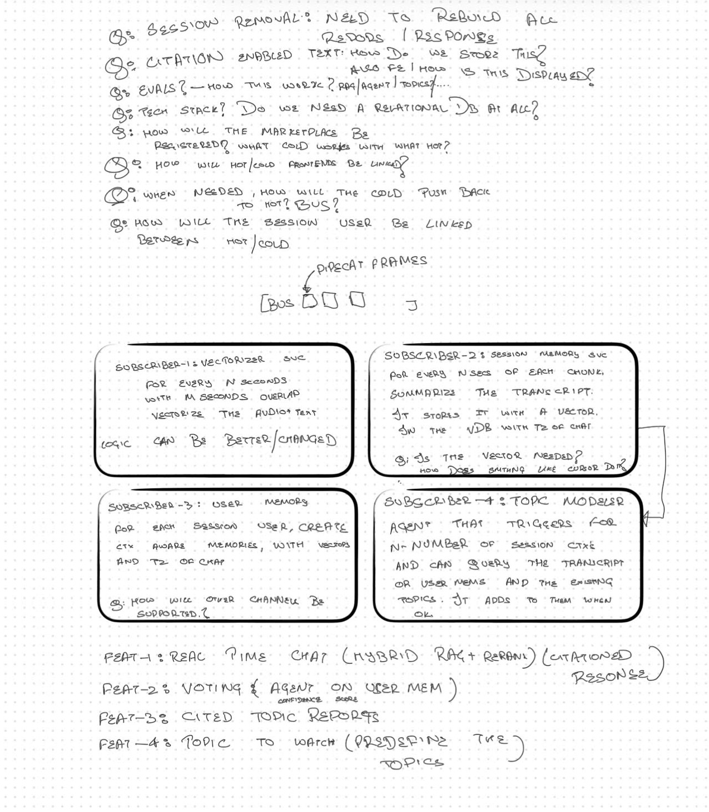

# Sensemaker product requirements

## 1. Document status

- **Status:** Logical PRD
- **Product:** Sensemaker
- **Date:** 2026-11-28
- **Home:** This directory. It is the whole product definition for Sensemaker.
- **Source sketch:**

- **Split:** Sensemaker is a separate product from the live session runtime. It ships as its own process and its own store. The directory can move into its own repository without taking the live-session design with it. The only shared surface is the frame contract in section 5.

This document states what Sensemaker must do and the decisions that keep it detachable. Storage engines, model vendors, table shapes, and worker code stay out of it.

## 2. Product thesis

> A live conversation becomes cited, revisable knowledge: memories, topics, and answers that still point at the turns they came from.

Sensemaker listens to repeated frames of stable conversation text. It keeps four derived layers — embedded passages, session memory, user memory, and topics — and it answers from those layers with the source turns attached. When a source session is removed, every record and every stored answer that depended on it is rebuilt or withdrawn.

The live session runtime is one producer of those frames. A recording importer or another conversation product can be another producer. Sensemaker does not join a media session, and it does not read the producer's tables.

## 3. Who it is for

- A participant who asks, during or after a conversation, what was said, what a person tends to mean, or what a topic has become, and who needs the answer tied to the words that support it.
- An operator who pins a topic and wants that topic kept current as new sessions arrive.
- A later marketplace listing that runs Sensemaker as a cold worker beside other workers, each with its own store.

## 4. Principles

1. **Stable text in, cited knowledge out.** Partials and hypotheses stay with the producer. Sensemaker accepts a turn when the producer marks it stable.
2. **A claim is the unit of truth.** A summary, a user memory, a topic sentence, and a chat answer each carry the source turns they rest on. The prose and the claims are stored separately.
3. **Redelivery is normal.** The bus repeats frames. A second delivery of the same frame changes nothing.
4. **Removal rebuilds dependents.** Deleting a session is an input. Dependents are recomputed from whatever evidence remains, or removed when none remains.
5. **Subscribers are replaceable.** The vectorizer, the session summarizer, the user-memory agent, and the topic modeler share a trigger and a record shape. Their internal logic can be swapped without changing the records they write.
6. **Identity is borrowed.** Sensemaker does not own accounts. It stores the producer’s tenant, session, channel, speaker, and, when present, session user.
7. **Confidence is a vote.** A user memory is published with the agreement of more than one judgment. A single model score is not the product’s confidence.
8. **Results go back on the bus.** Anything a live client or the producer should see is a Sensemaker frame. Sensemaker does not call into the producer process.

## 5. Frame contract

The bus is the only coupling. Frames are repeated. Each frame has a stable id, a type, a schema version, a tenant, and an occurrence time. Consumers dedupe on the frame id.

### 5.1 Frames Sensemaker consumes

| Frame | What it carries | What Sensemaker does |
| --- | --- | --- |
| `session.opened` | Tenant, session, channel, start time, and the session user when the producer knows one | Opens a scope for later turns |
| `session.closed` | Tenant, session, channel, end time, reason | Stops waiting for turns from that session and lets interval subscribers flush |
| `session.removed` | Tenant, session | Retracts every claim from that session and rebuilds or deletes dependents |
| `turn.ready` | Tenant, session, channel, speaker, optional session user, start, end, text, producer sequence | The only turn Sensemaker embeds, summarizes, or cites |
| `turn.revised` | Same identity as the turn it replaces, plus the new text or bounds | Replaces that turn’s claims and marks dependents dirty |
| `turn.retracted` | The turn identity | Drops that turn’s claims and marks dependents dirty |

A producer that only emits session open, session close, and stable turns can feed the first milestone. Removal, revision, and retraction are part of the contract because stored answers must follow the source.

Ordering for one session follows the producer sequence. Timestamps order the spoken timeline. A frame from another tenant is never applied.

### 5.2 Frames Sensemaker emits

| Frame | When |
| --- | --- |
| `passage.embedded` | A stable turn, or a demand overlay, has been accepted into the passage index |
| `memory.session_updated` | A channel window has a new or replaced summary |
| `memory.user_updated` | A session user’s memory was created, revised, or withdrawn |
| `topic.updated` | A topic was created or extended |
| `topic.watch` | A pinned topic changed and a watcher should see it |
| `chat.answered` | A chat reply was stored, with its claims |
| `report.ready` | A cited topic report was stored |

These frames are how a live client, or the producer, hears cold results. The producer may subscribe. Sensemaker does not push by calling the producer.

### 5.3 Registration

A marketplace entry for Sensemaker declares:

- the product name and version
- the consume list above
- the emit list above
- the tenant scopes it may see

A worker started from that entry reads the frames it was granted and writes only its own frame types and its own store. Another worker can read Sensemaker’s frames. Sensemaker does not load inside the live session process, and the live session process does not load Sensemaker.

## 6. Objects Sensemaker owns

All of these live in Sensemaker’s store. None of them are rows in the producer’s session or transcript tables.

- **Passage.** One stable turn, kept so chat can retrieve it by words and by similarity. Optional overlay passages exist when a demand asks for a different chunking. Each passage points at one `turn.ready` frame.
- **Session memory.** A summary of one time window on one channel, plus the turns it covers. Written so a later chat can read the summary and open the turns.
- **User memory.** A statement about one session user, or about one session speaker until a session user is present. It carries the turns it came from, the channel, and a confidence vote.
- **Topic.** A durable subject that survives the sessions that formed it. It holds member turns and member memories, and it can be pinned as a watch.
- **Answer.** The stored reply to one chat question, or one section of a topic report. The reply text and its claims are separate.
- **Claim.** One source span: producer frame id, tenant, session, channel, speaker, start, end, and the quoted text. An answer, a memory, or a topic sentence references claims. It does not bury the source inside the sentence.
- **Watch.** A topic a user or operator asked to keep current.
- **Judgment.** One agent’s vote on a candidate user memory, kept so the confidence score can be shown and later eval’d.

Provenance across the producer boundary is the producer frame id together with tenant, session, and sequence, copied onto the claim. Sensemaker never infers that link by joining the producer’s database.

## 7. Subscribers

Each subscriber is a worker on the bus. It may run on a clock, on a count of new turns, or on a demand. Those triggers are configuration. The record it writes is not.

A subscriber writes its record once per input identity. A repeated frame does not create a second passage, summary, memory, or topic member.

### 7.1 Vectorizer

For every configured interval, and whenever a demand overlay asks, the vectorizer takes stable turn text and records passages that later retrieval can rank. The chunking rule is part of the subscriber, and it may be replaced. A replacement must still write passages that point at `turn.ready` frames.

Demands name a different overlay (a tighter window, a different model). They do not fork the turn itself.

### 7.2 Session memory

For every configured interval of each channel, the subscriber summarizes the stable turns in that window. It stores the summary text, the window bounds, the channel, and the claims. The summary is what chat reads. The claims are what a citation opens.

A vector on the summary is optional. Retrieval may rank summaries by topic similarity, by lexical match, or by cosine over an embedding. The product requirement is that the summary is findable with the turns it covers. A separate vector database is not a requirement.

### 7.3 User memory

For each session user, the subscriber creates or updates memories from the turns of that user. Each memory stores the statement, the claims, and the chat-ready wording.

Until a frame carries a session user, the memory stays attached to the session speaker and is not merged with anyone else. When a later frame links that speaker to a session user, Sensemaker rewrites the attachment and rebuilds the user’s memories from the claims.

Other channels are summarized into the same user memory when three things hold: the tenant matches, the session user matches, and the watcher’s scope includes those channels. Channels of another tenant, and speakers with no session user, stay separate.

### 7.4 Topic modeler

After a configured number of session chats, an agent reads the transcript passages, the user memories, and the topics already stored. It extends an existing topic when the new evidence belongs to it, and it opens a new topic when it does not. A topic is written with the claims that justified the change.

The modeler queries. It does not receive a private copy of the producer’s transcript. Topics persist after the sessions that created them, which is what a watch in section 8.4 reads.

## 8. Features

### 8.1 Real-time chat

A person asks a question against one scope: the current session, a channel, a session user, or a set of topics they can see.

Sensemaker retrieves with a hybrid of lexical match and similarity, reranks the candidates, and writes an answer whose sentences reference claims. The reply is a `chat.answered` frame so a live client can show it while the session is still open.

The answer abstains when the retrieved claims do not support it. An abstention is stored and carries no invented claim.

**Done when:** a question asked during a live session returns an answer whose citations open the quoted turns, and the same question asked again after a repeated frame returns the same answer identity.

### 8.2 Voting on user memory

A candidate user memory is proposed by one agent. Further judgments, from the same agent family or another, vote to keep, edit, or reject it. The confidence score stored on the memory is the agreement of those votes, with the judgments kept beside it.

A memory below the configured agreement stays a candidate. Chat and topic reports cite published memories. They can show a candidate only when the question asked for uncertain memories, and the answer marks it as a candidate.

**Done when:** a memory shown in chat has a confidence score that matches the stored votes, and a rejected candidate is absent from an ordinary answer.

### 8.3 Cited topic reports

A report is a durable answer over one topic. Each section is an answer object: prose plus claims. The report lists the sessions and the time span it covers.

Regenerating a report after new turns, or after a retraction, writes a new revision and keeps the previous one until retention says otherwise.

**Done when:** a reader can open any sentence in the report and land on the turn text that supports it, and a retracted turn disappears from the next revision.

### 8.4 Topics to watch

A watch pins a topic. As further sessions arrive, the topic modeler updates that topic, and Sensemaker emits `topic.watch` with the new claims. The topic remains after the individual sessions are closed.

Closing a watch stops the frames. It does not delete the topic. Removing the last supporting session rebuilds the topic or withdraws it, and the watch frame says which.

**Done when:** a pinned topic gains a new cited member from a later session, and a client subscribed only to `topic.watch` can show that change.

## 9. Session removal

`session.removed` is mandatory, not an administrative afterthought.

On that frame Sensemaker:

1. Deletes passages, claims, and judgments whose only source is that session.
2. Marks every session memory, user memory, topic, answer, and report that cited the session.
3. Rebuilds each marked object from the claims that remain.
4. Deletes an object whose remaining claims are empty.
5. Emits the corresponding update or withdrawal frames.

Stored chat answers are included. An answer that lost its support is withdrawn even if the client already displayed it. The client learns that from `chat.answered` with a withdrawn status, or from the absence of the answer on the next read.

A revision (`turn.revised`) uses the same path for the one turn: replace the claim, mark dependents, rebuild.

## 10. How citations are stored and shown

**Stored.** The answer (or memory, or topic sentence) keeps its own text. Each citation is a claim record: producer frame id, tenant, session, channel, speaker, start, end, quote. A sentence references claim ids. The quote is copied so a citation still displays after the producer has been asked to delete media, until Sensemaker itself applies `session.removed`.

**Shown.** Sensemaker returns the text and the claims. The client renders a citation on the sentence and opens the quote, the speaker, and the time span. Sensemaker does not choose the widget. A client that cannot render claims still receives the quote list and must not drop it.

Two answers that share a turn share the claim identity, so one retraction updates both.

## 11. Session user across the boundary

The producer is the authority for who the session user is. When it knows, `session.opened` and `turn.ready` carry that id. Sensemaker stores it as an external principal and groups user memory by tenant plus that id.

When the producer does not know, Sensemaker keeps speaker-scoped memories and does not invent a user. A later frame that names the session user for that speaker is the link. Sensemaker then rebuilds user memory under that principal.

Sensemaker does not authenticate the person and does not read the producer’s account directory.

## 12. Evals

Every subscriber and the chat agent record the model id, the prompt version, and the frame ids they read.

An eval set is a fixed list of input frames plus the expected shape of the output:

- claims that must be present
- claims that must be absent
- an expected abstention, where the honest answer is silence

The vectorizer is scored on whether the passage still points at the right turn after a logic change. Session memory is scored on whether the summary’s claims cover the window and do not cite turns outside it. User memory is scored on vote agreement against a labeled keep, edit, or reject. The topic modeler is scored on attaching a turn to the existing topic versus opening a new one. Chat is scored on citation precision and on abstention.

A model swap is allowed when the eval set for that subscriber holds. The subscriber’s record shape stays the same.

## 13. What this product leaves undecided

These stay open because the product works either way:

- The store engine. The requirement is durable claims, deletion by session and by tenant, and hybrid retrieval. A relational database may be used. It is not required by this PRD.
- Where similarity is computed. An embedding column, an external index, or topic ranking may satisfy section 7.2.
- The interval and the turn counts. They are configuration per deployment, with defaults chosen when the first worker is built.
- Which model sits behind each subscriber. Section 12 is the gate.
- How a live client authenticates to Sensemaker’s read API. The frames are the integration; the client session is a later interface PRD.

## 14. Out of scope

- Capturing audio, diarization, partial transcripts, and the live media session.
- Account registration, passwords, and tenant administration.
- A general marketplace, other than the registration record Sensemaker needs in order to run as one worker.
- Writing the producer’s schema or importing the producer’s code.
- Tool calls that change systems outside Sensemaker (tickets, mail, CRM).

## 15. Standing on its own

Sensemaker is extractable when all of the following are true:

- Its process starts without the live session runtime installed.
- Its tests feed the frames in section 5 and never open the producer’s database.
- Its store holds only the objects in section 6.
- A second producer can be simulated by publishing the same frames.

Until that extraction, this directory remains the product definition. Implementation of Sensemaker, when it starts, follows this PRD in the Sensemaker repository or in a Sensemaker package, and does not extend the live-session design.
